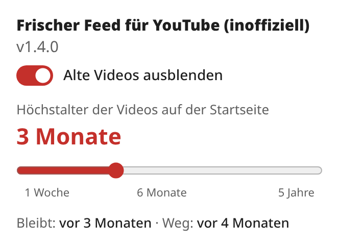

# Frischer Feed für YouTube (inoffiziell)

[English](README.md)

Eine Browser-Erweiterung für Chrome und Firefox. Sie blendet auf der **YouTube-Startseite** Videos aus, die älter sind
als eine selbst gewählte Grenze – irgendwo zwischen 1 Woche und 5 Jahren. Die Startseite mischt jahrealte Videos
zwischen neue; mit der Erweiterung zeigt sie nur noch, was dir frisch genug ist. Abos, Suche, Kanalseiten und der Player
bleiben unverändert.



> **Nicht mit Google oder YouTube verbunden.** Unabhängiges, inoffizielles Projekt.
> „YouTube“ ist eine Marke der Google LLC.

## Funktionen

- **Ein/Aus-Schalter:** Auf das Erweiterungssymbol klicken; „Alte Videos ausblenden“ schaltet den Filter aus und an.
  Ausgeschaltet sind alle ausgeblendeten Videos sofort wieder da; die Grenze bleibt für das nächste Mal gespeichert.
- **Eigene Grenze:** Im selben Popup den Regler verschieben. Darunter steht, welches Alter gerade
  noch bleibt und welches schon verschwindet. Änderungen wirken sofort, auch in bereits offenen YouTube-Tabs.
- **Funktioniert in jeder YouTube-Sprache:** Die Erweiterung liest das Alter, das YouTube unter jedes Video schreibt
  („vor 3 Monaten“, „3 months ago“, „il y a 3 mois“, „3 месяца назад“, auch „vor 2 Tagen gestreamt“).
  Getestet mit 909 echten YouTube-Texten in 27 Sprachen, in Chrome und in Firefox: alle erkannt.
- **Nichts verschwindet aus Versehen:** Videos ohne erkennbares Alter – Livestreams, Shorts, Werbung, angekündigte
  Premieren – bleiben immer sichtbar.
- **Schlank:** eine einzige Berechtigung (`storage`), kein Netzwerkzugriff, kein Hintergrundskript.

## Einstellung

| Stufen des Reglers | Beispiel: Grenze „3 Monate“ |
|---|---|
| 1, 2, 3, 4 Wochen · 1–11 Monate · 1–5 Jahre | „vor 3 Monaten“ bleibt · „vor 4 Monaten“ verschwindet |

Die Stufen sind genau die, in denen YouTube das Alter anzeigt: Nach 4 Wochen heißt es „vor 1 Monat“, nach 11 Monaten
„vor 1 Jahr“. Feinere Stufen (etwa 100 Tage) hätten keine Wirkung, weil YouTube nie so genau anzeigt.
Standard: Filter an, 4 Wochen. Beide Einstellungen werden lokal im Browserprofil gespeichert.

## Sprachen

- **Alterserkennung:** jede Sprache, die YouTube anbietet – nichts ist pro Sprache fest eingebaut (siehe [Wie es funktioniert](#wie-es-funktioniert)).
- **Name und Popup:** 29 Sprachen: alle 24 EU-Amtssprachen (bg, cs, da, de, el, en, es, et, fi, fr, ga, hr, hu, it, lt,
  lv, mt, nl, pl, pt, ro, sk, sl, sv) plus Norwegisch, Ukrainisch, Russisch, Türkisch und Katalanisch. Das Popup folgt der
  Browsersprache, sonst Englisch. Popup-Texte stehen in `i18n.js`, Name und Beschreibung in `_locales/` (Chrome kennt dort
  kein Irisch und Maltesisch; die fallen auf Englisch zurück). Einheiten wie „3 Monate“ liefert der Browser.
  Die Übersetzungen sind maschinell erstellt und nicht von Muttersprachlern geprüft – Korrekturen sind willkommen.

## Installation

### Chrome

1. `youtube-fresh-feed-<version>.zip` aus dem [neuesten Release](../../releases/latest) laden und entpacken (oder dieses Repository klonen).
2. In Chrome `chrome://extensions` öffnen.
3. Oben rechts den **Entwicklermodus** einschalten.
4. **Entpackte Erweiterung laden** klicken und den entpackten Ordner wählen.
5. Offene YouTube-Tabs neu laden.

Funktioniert auch in anderen Chromium-Browsern wie Vivaldi, Brave oder Edge (`vivaldi://extensions` usw.).

### Firefox (ab 142)

1. Das [neueste Release](../../releases/latest) in Firefox öffnen und auf `youtube-fresh-feed-<version>-firefox.xpi` klicken.
2. Firefox fragt, ob github.com ein Add-on installieren darf: **Weiter zur Installation**, dann **Hinzufügen**.
3. Offene YouTube-Tabs neu laden.

Lädt Firefox die Datei nur herunter: `about:addons` öffnen, auf das Zahnrad klicken, **Add-on aus Datei installieren…**
wählen und die Datei auswählen. Jedes Release enthält eine von Mozilla signierte Firefox-Datei. Zum Aktualisieren die
Datei eines neueren Releases genauso installieren; die Einstellung bleibt erhalten. Wird auf YouTube nichts ausgeblendet,
in `about:addons` bei der Erweiterung den Reiter **Berechtigungen** prüfen.

### Pakete bauen

`./build.sh [git-ref]` baut beide Pakete aus einem Commit oder Tag (Standard: `HEAD`) nach `dist/`:
das Chrome-ZIP und ein Firefox-ZIP zum Signieren. Der Code ist für beide gleich; für Firefox ergänzt das Skript in
`manifest.json` nur die Add-on-ID, die Mindestversion und die Erklärung zur Datenerhebung („keine“).

### Firefox-Paket signieren (Betreuer)

Firefox installiert Add-ons nur dauerhaft, wenn sie signiert sind. Das Signieren ist kostenlos und erledigt Mozilla.

1. Erst testen: in Firefox `about:debugging` → **Dieser Firefox** → **Temporäres Add-on laden…** und
   `dist/firefox/manifest.json` wählen. Mozilla nimmt jede Versionsnummer nur einmal an.
2. API-Zugangsdaten unter <https://addons.mozilla.org/de/developers/addon/api/key/> erzeugen und in
   `~/.config/youtube-fresh-feed/amo-api.env` eintragen (`WEB_EXT_API_KEY=<JWT issuer>`, `WEB_EXT_API_SECRET=<JWT secret>`, `chmod 600`).
3. `./sign-firefox.sh` lädt `dist/firefox` als nicht gelistete Version hoch, wartet auf die Signatur und speichert
   `dist/youtube-fresh-feed-<version>-firefox.xpi` für das GitHub-Release.
   `./sign-firefox.sh listed` reicht die Version stattdessen zur öffentlichen Listung auf addons.mozilla.org ein, mit Texten,
   Kategorie und Prüfhinweisen aus `amo-metadata.json`; Mozilla prüft sie, bevor sie erscheint.

## Datenschutz

- Die Erweiterung läuft nur auf `https://www.youtube.com/*` und verlangt eine einzige Berechtigung: `storage`, für Schalter und Grenze.
  In Firefox erklärt sie, dass sie keine Daten erhebt.
- Sie schickt **überhaupt keine Anfragen** – sie liest nur Text, der schon auf der Seite steht, und blendet Elemente aus.
- Keine Statistik, kein Tracking, keine fremden Server. Was du anschaust, bleibt zwischen dir und YouTube.

## Wie es funktioniert

- **Das Alter lesen, nicht YouTubes Code:** YouTube benennt seine internen CSS-Klassen oft um, der Alterstext unter einem
  Video ändert sich dagegen kaum. Die Erweiterung sucht kurze Texte, die genau eine Altersangabe sind („vor 3 Monaten“, auf
  Wunsch mit bis zu drei Wörtern wie „gestreamt“ davor oder dahinter), und blendet die zugehörige Video-Kachel aus.
- **Jede Sprache geschenkt:** YouTube formatiert diese Texte mit den Unicode-CLDR-Daten, die Browser auch für
  `Intl.RelativeTimeFormat` mitbringen – Deutsch im Stil `short` („vor 6 Std.“), Englisch im Stil `narrow` („3mo ago“).
  Deshalb lässt die Erweiterung beim Start den Browser jede mögliche Altersangabe in YouTubes Seitensprache schreiben
  (alle Einheiten, alle drei Stile, rund 2.000 Texte) und legt sie in einer Nachschlagetabelle ab. Ein Alter erkennen ist
  dann ein einziges Nachschlagen – keine regulären Ausdrücke und keine handgeschriebenen Muster pro Sprache. Ergeben zwei
  Einheiten in einer Sprache denselben Text, gewinnt die kleinere, damit ein Video im Zweifel sichtbar bleibt (in den
  29 Sprachen kommt das nicht vor).
- **Nur die Startseite:** Gefiltert wird innerhalb von `ytd-browse[page-subtype="home"]`. YouTube behält andere Seiten
  beim Navigieren im DOM; so bleiben auch Abos und Suche unberührt.
- **Scrollen und Recycling:** Ein `MutationObserver` prüft die Seite höchstens alle 250 ms neu. YouTube verwendet Kacheln
  für neue Videos wieder; deshalb blendet jede Prüfung Kacheln auch wieder ein, deren neues Video frisch genug ist.

## Grenzen

- **Ausblenden ist kein Empfehlen:** Die Erweiterung kann YouTube nicht dazu bringen, neuere Videos vorzuschlagen.
  Sind die meisten Vorschläge alt, wird die Startseite dünn, und YouTube lädt beim Scrollen mehr nach.
- **YouTube rundet:** „vor 1 Monat“ steht für eine Spanne von Tagen, nicht für ein genaues Alter; die Erweiterung
  rechnet einen Monat als 30 und ein Jahr als 365 Tage.
- **Hängt an YouTubes Seite:** Ändert YouTube die Elemente einer Video-Kachel (`ytd-rich-item-renderer`,
  `yt-lockup-view-model` …), wird nichts mehr ausgeblendet, bis die Erweiterung angepasst ist. Mehr als gewollt blendet sie nie aus.
- Ein Videotitel, der nur aus einer Altersangabe besteht („vor 3 Jahren“), würde als Alter des Videos gelesen.

## Tests

```sh
node test/test.js     # Alterserkennung: 909 echte YouTube-Texte in 27 Sprachen + Randfälle
google-chrome-stable --headless=new --user-data-dir=/tmp/ff-test --allow-file-access-from-files \
  --virtual-time-budget=4000 --dump-dom "file://$PWD/test/testseite.html" | grep -o '<title>.*</title>'
```

`test/zeitangaben/` enthält die Altersangaben echter YouTube-Suchergebnisse, eine Datei pro Oberflächensprache.
Der zweite Test lässt `content.js` auf einer nachgebauten Startseite mit Endlos-Scroll und wiederverwendeten Kacheln
laufen und ändert die Einstellungen
Schritt für Schritt (28 Tage, 7 Tage, Filter aus, Filter wieder an, 5 Jahre).

## Lizenz

[MIT](LICENSE)
