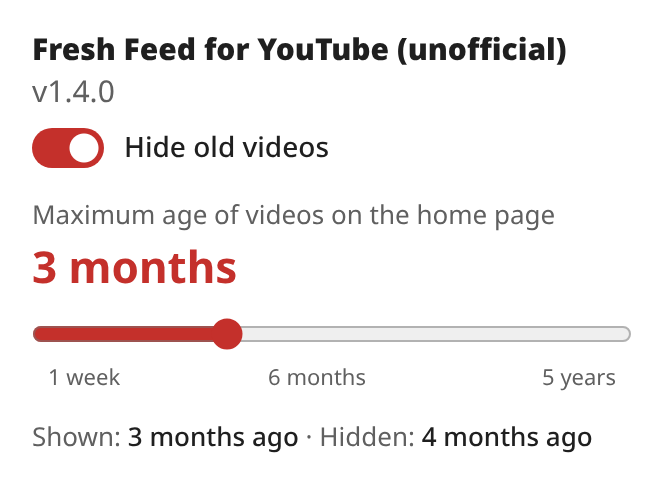

# Fresh Feed for YouTube (unofficial)

[Deutsch](README.de.md)

A browser extension for Chrome and Firefox. It hides videos on the **YouTube home page** that are older than a limit
you choose – anything from 1 week to 5 years. The home page mixes years-old videos in between new ones; with this
extension it only shows what is recent enough for you. Subscriptions, search, channel pages and the player stay untouched.



> **Not affiliated with Google or YouTube.** This is an independent, unofficial project.
> “YouTube” is a trademark of Google LLC.

## Features

- **On/off switch:** click the extension icon; “Hide old videos” turns the filter off and on. Switched off, every
  hidden video comes back at once; your limit is kept for the next time.
- **Your own limit:** move the slider in the same popup. Below the slider you see which age is still shown
  and which is already hidden. Changes apply at once, also in YouTube tabs that are already open.
- **Works in every YouTube language:** the extension reads the age YouTube writes under each video
  (“3 months ago”, “vor 3 Monaten”, “il y a 3 mois”, “3 месяца назад”, also “Streamed 2 days ago”).
  Tested with 909 real texts from YouTube in 27 languages, in Chrome and in Firefox: all recognised.
- **Nothing disappears by mistake:** videos without a recognisable age – live streams, Shorts, ads, upcoming
  premieres – always stay visible.
- **Lightweight:** a single permission (`storage`), no network access, no background script.

## Settings

| Slider steps | Example: limit “3 months” |
|---|---|
| 1, 2, 3, 4 weeks · 1–11 months · 1–5 years | “3 months ago” stays · “4 months ago” is hidden |

The steps are exactly the ones YouTube uses to show a video's age: after 4 weeks it says “1 month ago”, after
11 months “1 year ago”. Finer steps (say, 100 days) would have no effect, because YouTube never shows that precision.
Default: filter on, 4 weeks. Both settings are stored locally in your browser profile.

## Languages

- **Age recognition:** any language YouTube offers – nothing is hard-coded per language (see [How it works](#how-it-works)).
- **Name and popup:** 29 languages: all 24 official EU languages (bg, cs, da, de, el, en, es, et, fi, fr, ga, hr, hu,
  it, lt, lv, mt, nl, pl, pt, ro, sk, sl, sv) plus Norwegian, Ukrainian, Russian, Turkish and Catalan. The popup follows
  the browser language; English is the fallback. Popup texts live in `i18n.js`, the name and description in `_locales/`
  (Chrome has no Irish or Maltese locale there; those fall back to English). Units such as “3 months” come from the browser.
  The translations are machine-generated and have not been reviewed by native speakers – corrections are welcome.

## Installation

### Chrome

1. Download `youtube-fresh-feed-<version>.zip` from the [latest release](../../releases/latest) and unzip it (or clone this repository).
2. Open `chrome://extensions` in Chrome.
3. Turn on **Developer mode** (top right).
4. Click **Load unpacked** and select the unzipped folder.
5. Reload any open YouTube tabs.

Also works in other Chromium browsers such as Vivaldi, Brave or Edge (`vivaldi://extensions` etc.).

### Firefox (142 or later)

1. Open the [latest release](../../releases/latest) in Firefox and click `youtube-fresh-feed-<version>-firefox.xpi`.
2. Firefox asks whether github.com may install an add-on: click **Continue to Installation**, then **Add**.
3. Reload any open YouTube tabs.

If Firefox only downloads the file: open `about:addons`, click the gear icon, choose **Install Add-on From File…**
and select the file. Every release contains a Firefox file signed by Mozilla. To update, install the file of a newer
release the same way; your setting is kept. If nothing is hidden on YouTube, check the **Permissions** tab of the
extension in `about:addons`.

### Building the packages

`./build.sh [git-ref]` builds both packages from a commit or tag (default: `HEAD`) into `dist/`:
the Chrome ZIP and a Firefox ZIP for signing. The code is the same for both; for Firefox the script only adds the
add-on ID, the minimum version and the data-collection declaration (“none”) to `manifest.json`.

### Signing the Firefox package (maintainers)

Firefox only installs signed add-ons permanently. Signing is free and done by Mozilla.

1. Test first: in Firefox open `about:debugging` → **This Firefox** → **Load Temporary Add-on…** and select
   `dist/firefox/manifest.json`. Mozilla accepts every version number only once.
2. Create API credentials at <https://addons.mozilla.org/en-US/developers/addon/api/key/> and put them into
   `~/.config/youtube-fresh-feed/amo-api.env` (`WEB_EXT_API_KEY=<JWT issuer>`, `WEB_EXT_API_SECRET=<JWT secret>`, `chmod 600`).
3. `./sign-firefox.sh` uploads `dist/firefox` as an unlisted version, waits for the signature and saves
   `dist/youtube-fresh-feed-<version>-firefox.xpi` for the GitHub release.
   `./sign-firefox.sh listed` submits the version for public listing on addons.mozilla.org instead, with the texts,
   category and reviewer notes from `amo-metadata.json`; Mozilla reviews it before it appears.

## Privacy

- The extension only runs on `https://www.youtube.com/*` and requests a single permission: `storage`, for the switch and the limit.
  In Firefox it declares that it collects no data.
- It sends **no requests at all** – it only reads text that is already on the page and hides elements.
- No analytics, no tracking, no third-party servers. What you watch stays between you and YouTube.

## How it works

- **Reading the age, not YouTube's code:** YouTube renames its internal CSS classes often, but the age text under a
  video rarely changes. The extension looks for short texts that are exactly an age (“3 months ago”, optionally with up to
  three words such as “Streamed” around it) and hides the video tile they belong to.
- **Every language for free:** YouTube formats these texts with the Unicode CLDR data that browsers also ship for
  `Intl.RelativeTimeFormat` – German uses the `short` style (“vor 6 Std.”), English the `narrow` style (“3mo ago”).
  So at start the extension lets the browser write every possible age text in YouTube's page language (all units, all
  three styles, about 2,000 texts) into a lookup table. Recognising an age is then a single table lookup – no regular
  expressions and no hand-written patterns per language. If two units produce the same text in some language, the
  smaller one wins, so a video stays visible in case of doubt (no such case exists in the 29 languages).
- **Only the home page:** it filters inside `ytd-browse[page-subtype="home"]`. YouTube keeps other pages in the DOM
  while you navigate, so this also leaves subscriptions and search alone.
- **Scrolling and recycling:** a `MutationObserver` re-checks the page at most every 250 ms. YouTube reuses tiles for
  new videos, so every check also shows tiles again whose new video is recent enough.

## Limitations

- **Hiding is not recommending:** the extension cannot make YouTube suggest newer videos. If most suggestions are
  old, the home page gets sparse and YouTube loads more while you scroll.
- **YouTube rounds:** “1 month ago” stands for a range of days, not an exact age; the extension counts a month as
  30 days and a year as 365.
- **Depends on YouTube's page:** if YouTube changes the elements that make up a video tile (`ytd-rich-item-renderer`,
  `yt-lockup-view-model` …), nothing is hidden any more until the extension is updated. It never hides more than it should.
- A video title that consists of nothing but an age text (“3 years ago”) would be read as the video's age.

## Tests

```sh
node test/test.js     # age recognition: 909 real YouTube texts in 27 languages + edge cases
google-chrome-stable --headless=new --user-data-dir=/tmp/ff-test --allow-file-access-from-files \
  --virtual-time-budget=4000 --dump-dom "file://$PWD/test/testseite.html" | grep -o '<title>.*</title>'
```

`test/zeitangaben/` holds the age texts of real YouTube search results, one file per interface language.
The second test runs `content.js` on a mock home page with endless scrolling and recycled tiles, and changes the settings
step by step (28 days, 7 days, filter off, filter on again, 5 years).

## License

[MIT](LICENSE)
